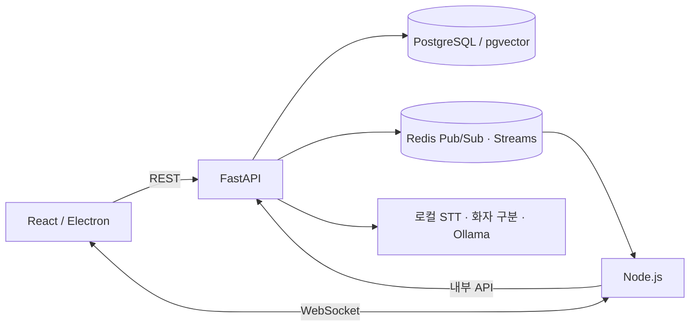

# MeetingAI — AI 회의 보조 데스크톱 앱

회의 음성을 전사하고, 화자를 구분하며, 안건·결정 사항·요약을 한 화면에서 확인하는 프로젝트입니다. React/Electron 클라이언트와 FastAPI API, Node.js 실시간 서버를 연결했습니다.

## 해결하려던 문제

회의에서는 발화가 계속 쌓이지만, 어떤 안건이 결정됐고 어떤 내용이 다시 논의됐는지 정리하기 어렵습니다. 녹음·전사·안건 상태·실시간 알림을 연결해 회의 도중의 변화와 종료 후 기록을 함께 다루도록 구성했습니다.

## 사용자 흐름

1. 로그인 후 워크스페이스와 회의방을 선택합니다.
2. 회의 중 발화·안건·알림을 실시간으로 확인합니다.
3. 녹음에 음성 인식과 화자 구분을 적용합니다.
4. 회의 기록에서 요약·액션 아이템과 관련 문서를 조회합니다.

## 구현 구조



| 구성 | 역할 |
| --- | --- |
| React · TypeScript · Electron | 회의·워크스페이스 화면과 데스크톱 실행 |
| FastAPI · SQLAlchemy | 인증·권한, 데이터 저장, 안건 상태와 분석 API |
| Node.js · WebSocket | 회의방 단위 실시간 이벤트 전달 |
| PostgreSQL · pgvector | 업무 데이터와 임베딩 검색 |
| Redis Pub/Sub · Streams | 이벤트 전파와 재접속 시 이력 재생 |
| faster-whisper · SpeechBrain · Ollama | 음성 인식, 화자 구분, 로컬 요약 |

## 설계와 문제 해결

- **실시간 전달과 데이터 저장의 책임 분리:** FastAPI가 업무 규칙과 저장을 담당하고 Node.js가 연결·방 단위 전달을 담당합니다.
- **재접속 복구:** 즉시 전달은 Pub/Sub, 연결이 끊긴 동안의 이벤트 재생은 Streams로 구성했습니다.
- **회의 데이터 보호:** JWT와 워크스페이스 권한 확인, 원본 오디오 서명 링크, 민감 로그 마스킹을 적용합니다.
- **모델 의존성의 실패 처리:** 로컬 모델을 사용할 수 없는 상황과 일반 회의 기록 기능을 구분합니다.

## 검증과 한계

백엔드 단위 테스트 33개와 프론트엔드·실시간 서버 타입 검사, 프론트엔드 빌드를 확인했습니다. 자세한 범위는 [검증 기록](docs/PUBLIC_VALIDATION.md)에 있습니다. 실제 마이크·모델·DB·Redis를 연결한 전체 흐름, 장시간 회의와 다중 서버 운영은 별도 검증이 필요합니다. 단위 테스트 결과를 음성 인식 정확도나 서비스 운영 성과로 표현하지 않습니다.

## 실행 환경

- Node.js 22.12 이상
- Python 3.11 권장
- Docker Compose: PostgreSQL과 Redis 실행
- Ollama: 로컬 요약 모델 사용 시 필요
- 데스크톱 패키징: macOS / Apple Silicon 기준

모델과 Python 의존성은 용량이 큽니다. 처음 음성 인식·임베딩·화자 구분 모델을 사용할 때 모델 파일 다운로드가 필요할 수 있습니다.

## 빠른 시작

```bash
git clone https://github.com/choisung-ho/meetingai.git
cd meetingai
python3 -m venv .venv
source .venv/bin/activate
python -m pip install -r backend/requirements.txt
npm run install:all
cp .env.example .env
cp backend/.env.example backend/.env
cp realtime-server/.env.example realtime-server/.env
cp frontend/.env.example frontend/.env
```

다음 설정을 실제 실행 환경에 맞게 바꿉니다.

| 파일 | 설정 |
| --- | --- |
| `.env` | 개발 DB 비밀번호 `POSTGRES_PASSWORD` |
| `backend/.env` | 같은 DB 비밀번호를 넣은 `DATABASE_URL`, 임의 생성한 `SECRET_KEY` |
| `realtime-server/.env` | 백엔드와 **동일한** `SECRET_KEY`, 동일한 `REDIS_URL` |
| `frontend/.env` | API와 WebSocket 서버 주소 |

인증 키는 아래처럼 생성하고 백엔드와 실시간 서버에 같은 값을 넣습니다. 콜백·오디오 서명 키는 각각 다른 값으로 설정합니다.

```bash
python -c "import secrets; print(secrets.token_urlsafe(48))"
```

```bash
docker compose up -d
npm run dev
```

- 프론트엔드: `http://localhost:5173`
- API 문서: `http://localhost:8000/docs`
- WebSocket: `ws://localhost:8080`
- 개발 DB: `localhost:5433`

로컬 요약 모델을 사용하려면 Ollama를 설치하고 `ollama pull qwen2.5:7b`로 모델을 준비합니다. 모델 사용 여부와 장치는 `backend/.env`에서 설정합니다.

## 검증과 빌드

```bash
npm run test:backend
npm run typecheck:frontend
npm run typecheck:realtime
npm run build:frontend
```

백엔드 단위 테스트와 타입·빌드 검사는 실제 마이크, STT 모델, DB·Redis를 연결한 전체 동작 검증과 구분됩니다. 데스크톱 앱 패키징은 `./scripts/build-mac.sh`를 사용합니다.

## 상세 문서

- [백엔드 안내](backend/README_KO.md)
- [API 명세](backend/docs/api_spec_current.md)
- [실시간 서버](realtime-server/README.md)
- [통합 설계 기록](docs/INTEGRATION_NOTES.md)
- [데스크톱 배포 안내](docs/DEPLOY.md)

실제 회의 녹음·업로드 문서·개인 설정·개발 DB·설치 파일은 소스에 포함하지 않습니다.
