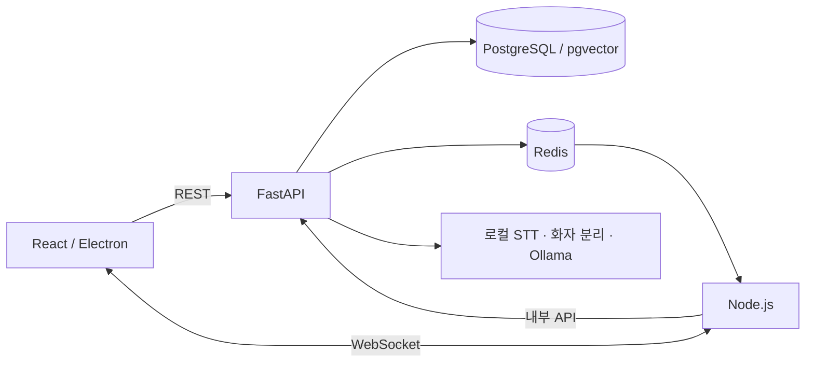

# MeetingAI

회의의 녹음·전사·화자 구분·안건 추적·요약을 하나의 데스크톱 앱으로 연결한 AI 회의 보조 프로젝트입니다. React/Electron 클라이언트, FastAPI API, Node.js 실시간 서버를 함께 구성했습니다.

## 주요 기능

- 회의방과 워크스페이스 관리, JWT 인증과 역할 기반 접근 제어
- WebSocket을 통한 회의 발화·안건·알림 전달
- Redis Pub/Sub과 Streams를 이용한 이벤트 전달과 재접속 복구
- faster-whisper 음성 인식과 SpeechBrain 기반 화자 구분
- 문서·발화 검색과 재논의 탐지
- Ollama를 이용한 회의 요약과 액션 아이템 생성

## 구조

```text
frontend/         React · Vite · Electron 데스크톱 클라이언트
backend/          FastAPI · SQLAlchemy · PostgreSQL API
realtime-server/  Node.js · WebSocket · Redis 이벤트 서버
docker-compose.yml PostgreSQL(pgvector) · Redis 개발 환경
```



## 실행 환경

- Node.js 22.12 이상
- Python 3.11 권장
- Docker Compose: PostgreSQL과 Redis 실행
- Ollama: 로컬 요약 모델 사용 시 필요
- 데스크톱 패키징: macOS / Apple Silicon 기준

모델과 Python 의존성은 용량이 큽니다. 처음 음성 인식·임베딩·화자 구분 모델을 사용할 때 모델 파일 다운로드가 필요할 수 있습니다.

## 빠른 시작

```bash
git clone https://github.com/choisung-ho/meetingai.git
cd meetingai
python3 -m venv .venv
source .venv/bin/activate
python -m pip install -r backend/requirements.txt
npm run install:all
cp .env.example .env
cp backend/.env.example backend/.env
cp realtime-server/.env.example realtime-server/.env
cp frontend/.env.example frontend/.env
```

다음 설정을 실제 실행 환경에 맞게 바꿉니다.

| 파일 | 설정 |
| --- | --- |
| `.env` | 개발 DB 비밀번호 `POSTGRES_PASSWORD` |
| `backend/.env` | 같은 DB 비밀번호를 넣은 `DATABASE_URL`, 임의 생성한 `SECRET_KEY` |
| `realtime-server/.env` | 백엔드와 **동일한** `SECRET_KEY`, 동일한 `REDIS_URL` |
| `frontend/.env` | API와 WebSocket 서버 주소 |

인증 키는 아래처럼 생성하고 백엔드와 실시간 서버에 같은 값을 넣습니다. 콜백·오디오 서명 키는 각각 다른 값으로 설정합니다.

```bash
python -c "import secrets; print(secrets.token_urlsafe(48))"
```

```bash
docker compose up -d
npm run dev
```

- 프론트엔드: `http://localhost:5173`
- API 문서: `http://localhost:8000/docs`
- WebSocket: `ws://localhost:8080`
- 개발 DB: `localhost:5433`

로컬 요약 모델을 사용하려면 Ollama를 설치하고 `ollama pull qwen2.5:7b`로 모델을 준비합니다. 모델 사용 여부와 장치는 `backend/.env`에서 설정합니다.

## 검증과 빌드

```bash
npm run test:backend
npm run typecheck:frontend
npm run typecheck:realtime
npm run build:frontend
```

백엔드 단위 테스트와 타입·빌드 검사는 실제 마이크, STT 모델, DB·Redis를 연결한 전체 동작 검증과 구분됩니다. 데스크톱 앱 패키징은 `./scripts/build-mac.sh`를 사용합니다.

## 상세 문서

- [백엔드 안내](backend/README_KO.md)
- [API 명세](backend/docs/api_spec_current.md)
- [실시간 서버](realtime-server/README.md)
- [통합 변경 내역](docs/INTEGRATION_NOTES.md)
- [배포 안내](docs/DEPLOY.md)

## 공개 범위

이 저장소는 통합 앱의 소스 코드와 개발 문서를 제공합니다. 실제 회의 녹음·업로드 문서·개발 DB·개인 설정·DMG·제출 ZIP은 포함하지 않습니다. 팀 프로젝트의 기존 코드와 문서 구조를 유지했으며, 이 저장소 자체가 전체 구현의 개인 단독 기여를 뜻하지 않습니다.

공개 준비 시 실행한 검사와 범위는 [검증 기록](docs/PUBLIC_VALIDATION.md)에 정리했습니다.
